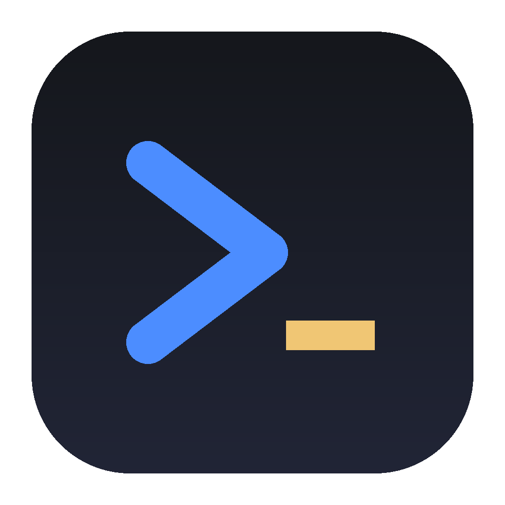
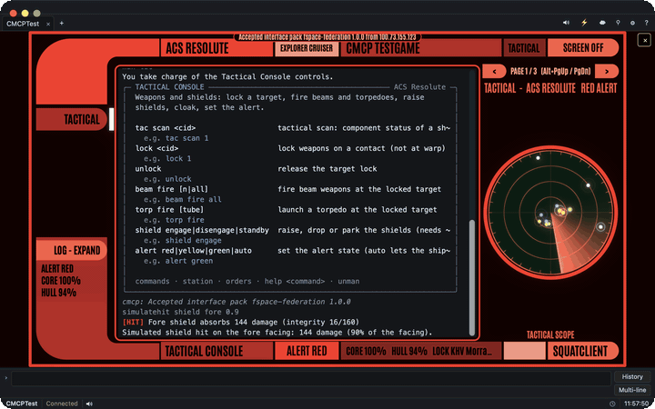
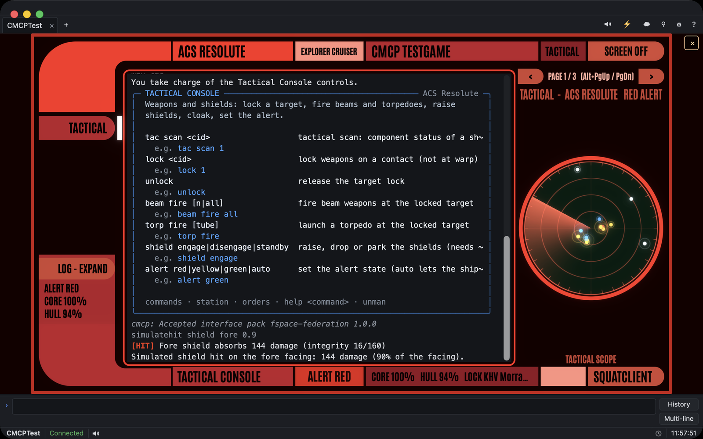
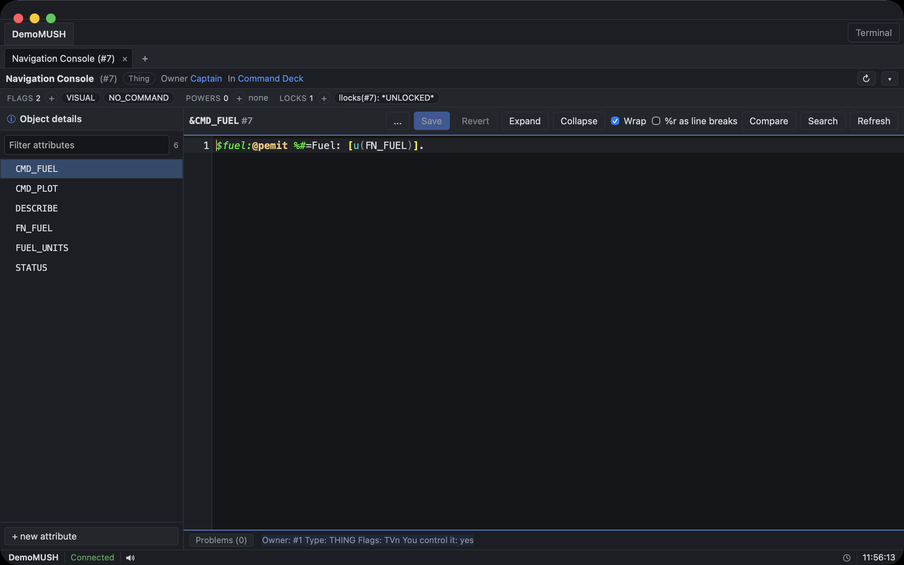
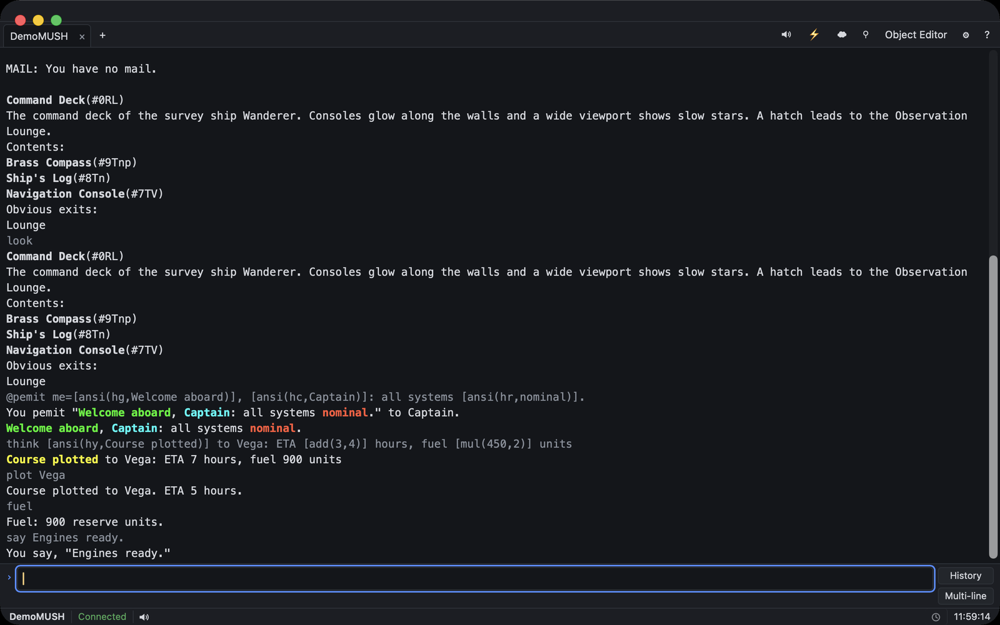
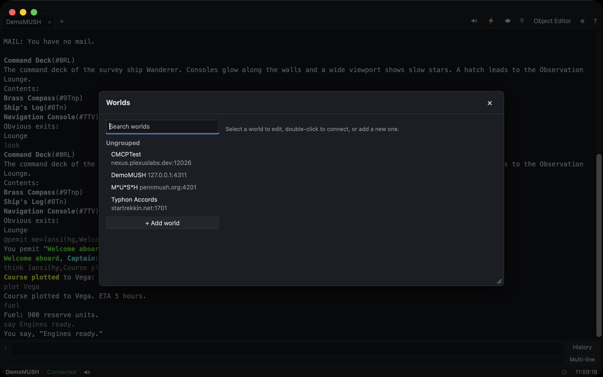
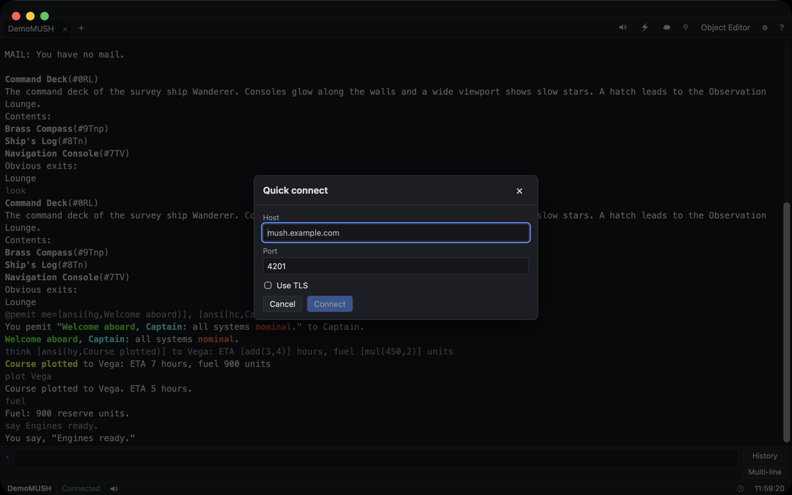
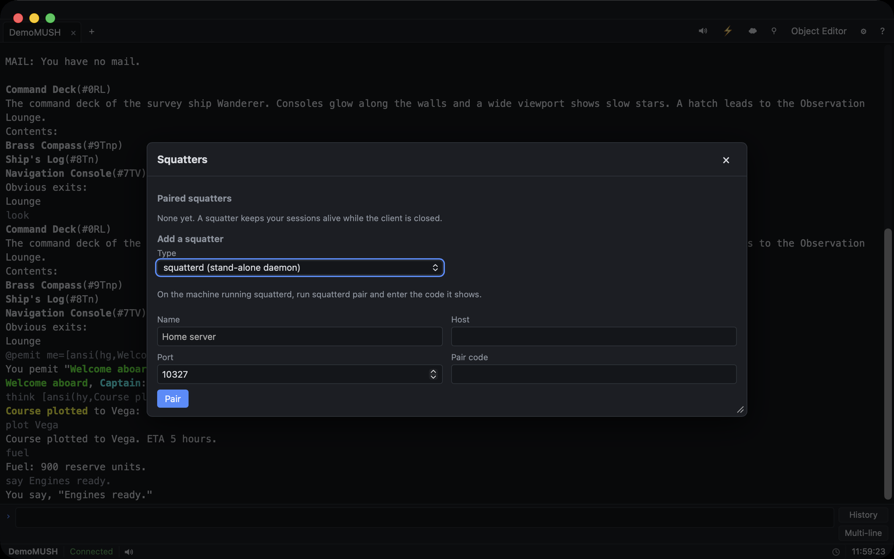
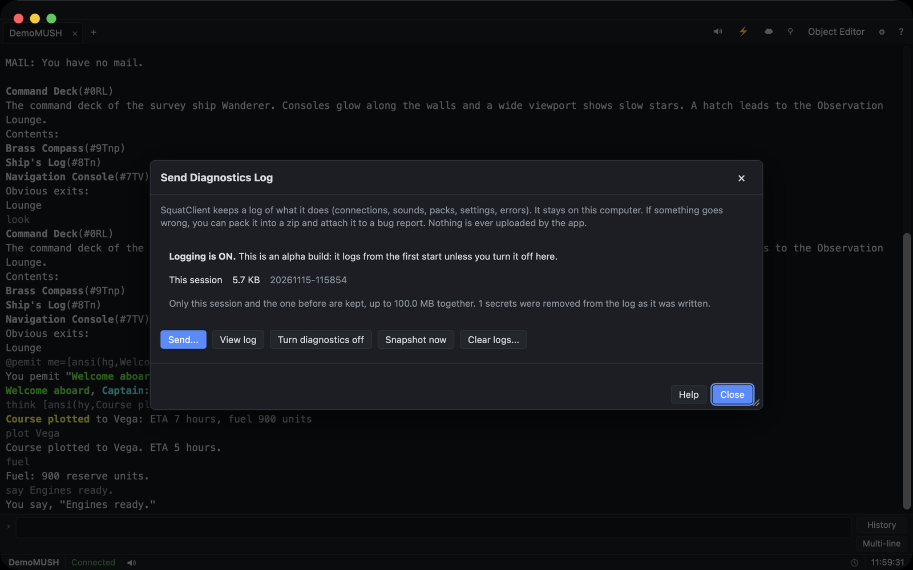

<p align="center"></p>

# SquatClient

**A MUD / MUSH / MU\* client where the game can draw its own consoles.**

SquatClient is a desktop client for text games that also speaks **CMCP**, a protocol that lets a game send the
*data* of an interface (gauges, radar, damage control, alerts, sound) instead of making you read it out of text. Where a
game has consoles, you get them: live, themed, clickable, with the text still right there. Where it does not, you get a
fast, scriptable, themeable MU\* client with an in-game object editor, TinyFugue and Lua scripting, and connections that
can stay alive while the window is closed.

<p align="center"></p>
<p align="center"><em>The tactical console of the CMCP test game, drawn from the game's own data. The ship takes hits; the display shakes, the log prints each hit, the radar keeps sweeping.</em></p>

It is free software, GPL-3.0-or-later. **Alpha:** expect rough edges; see
[Reporting problems](#reporting-problems-the-diagnostics-log).

- [Download](#download) · [Quickstart: connect directly](#quickstart-1-connect-directly) · [Quickstart: keep connections alive](#quickstart-2-keep-your-connections-alive-a-remote-squatter-or-gtf)
- [CMCP: consoles the game draws](#cmcp-consoles-the-game-draws) · [The object editor](#the-object-editor) · [Scripting](#scripting-tinyfugue-lua-and-webgl)
- [Protocols](#protocols-and-terminal-support) · [Themes and layouts](#themes-and-layouts) · [Squatters](#squatters-in-brief)
- [Build from source](#build-from-source) · [Files and settings](#files-and-settings) · [Documentation](#documentation) · [License](#license)

## Why SquatClient

| | |
|---|---|
| **Consoles, not text parsing** | With CMCP a game says "here is the ship's power, the contacts, the alert"; the client draws it. No triggers scraping lines, nothing to break when the game's wording changes. |
| **The text never goes away** | The output pane and your input line are never covered. Switch the screen off and you are back to plain text. |
| **Looks and sounds the game ships with it** | Screens, themes and sound packs come from the game (checked by hash, cached, with your consent), or from your own sound folder, which is never uploaded. |
| **A real MU\* client underneath** | Telnet, TLS, MCCP2, GMCP, MSDP, MSSP, 24-bit colour, UTF-8, saved worlds with keychain passwords, many tabs, searchable scrollback, history. |
| **Edit objects, not `@set` lines** | An in-game object and attribute editor for PennMUSH, CobraMUSH, TinyMUX and friends. |
| **Scriptable two ways, with graphics** | TinyFugue-compatible scripts and Lua, both able to draw WebGL scenes. |
| **Stays connected** | Hand your connections to a small relay (a *squatter*) or to [gtf](https://github.com/itsnotyoutoday/gtf), close the app, come back and replay what you missed. |

## See it

<table>
<tr>
<td width="50%"><a href="docs/screenshots/cmcp-tactical.png"></a><br><sub><b>A CMCP console.</b> Tactical console on the test game: commands, a radar scope, status chips, ship-wide red alert.</sub></td>
<td width="50%"><a href="docs/screenshots/editor.png"></a><br><sub><b>The object editor.</b> An attribute of an object on a CobraMUSH game, with syntax colouring, flags, locks and a filterable attribute list.</sub></td>
</tr>
<tr>
<td><a href="docs/screenshots/terminal.png"></a><br><sub><b>A regular world.</b> 24-bit colour, your own commands shown dimmed, a command line with history.</sub></td>
<td><a href="docs/screenshots/worlds.png"></a><br><sub><b>Worlds.</b> The alpha starts with the CMCP test game and two real games already in the list.</sub></td>
</tr>
</table>

## Download

Releases are published on the **[Releases page](https://github.com/itsnotyoutoday/squatclient/releases)**:

| Platform | File |
|---|---|
| Windows (x64) | installer or portable `.exe` |
| macOS (Apple silicon / Intel) | `.app` bundle in a `.zip` |
| Linux (x64) | `squatclient` binary (needs GTK 3 and WebKitGTK) |

The client is one self-contained program. The optional relays (`squatterd` and `tf-squatterd`) come from the
[squatClientDaemon](https://github.com/itsnotyoutoday/squatClientDaemon) repository, as static binaries for
Linux, macOS and Windows. If there is no release for your platform yet, [build it from source](#build-from-source).

**Code signing:** free code signing provided by [SignPath.io](https://about.signpath.io), certificate by
[SignPath Foundation](https://signpath.org). See the [code signing policy](#code-signing-policy).

## Quickstart 1: connect directly

No relay, no account, no setup. About two minutes.

**1. Start SquatClient.** On a first run the **Worlds** list already holds three games (**Cmd/Ctrl+O**, or *Worlds...* in the **Session** menu on a Mac and the **File** menu elsewhere; the **+** in the tab bar is *Quick connect*):

<p align="center"></p>

| World | What it is |
|---|---|
| **CMCPTest** | the alpha test game for CMCP: a small cooperative starship game with every console and sound. **Start here.** |
| **Typhon Accords** | a CobraMUSH game (startrekkin.net, port 1701) |
| **M\*U\*S\*H** | a PennMUSH game (pennmush.org, port 4201) |

**2. Double-click CMCPTest.** It connects and you see the game's welcome text.

**3. Make a throwaway account** (do not reuse a real password on a test game):

```
create yourname somepassword
```

**4. Board a ship and man a console:**

```
board resolute
man tac
```

The tactical console appears around the text. Try the buttons, then `simulatehit` to take a hit and watch the display shake. `unman` gives the console back; the **screen menu** at the top of a console switches between the ones you may use, **SCREEN OFF** brings back the plain text. More in the in-app help (**?**): *CMCP consoles and sound*.

**5. Connect to anything else.** Use **Quick connect** (host, port, TLS) or **+ Add world** in the Worlds dialog to save it with a login (the password goes to your system keychain, never to a file):

<p align="center"></p>

**6. Edit an object** (MU\* games only): press **Object Editor**, then **Open an object** or type `/edit #123` in the terminal. See [The object editor](#the-object-editor).

## Quickstart 2: keep your connections alive (a remote squatter, or gtf)

A **squatter** holds your game connections on a machine that stays on (a server, a Pi, a VPS). You attach with the app, it
replays what you missed, and you carry on; when you close the app the connections stay up. Pick one:

- **gtf**, if you want a terminal MU\* client you can also attach SquatClient to. [GoTinyFugue](https://github.com/itsnotyoutoday/gtf) is
  our TinyFugue-compatible terminal client and has the squatter **built in**: one program, nothing else to run. Recommended.
- **squatterd**, a small stand-alone relay: "screen for MUDs" with no client of its own.

Either way the link is TLS with a certificate whose fingerprint **you confirm once and the app pins**, plus a device key,
so a pairing code is needed only the first time. A squatter never stores your game passwords; the app sends your login.

### With gtf

On the machine that stays on:

```sh
curl -fsSL https://raw.githubusercontent.com/itsnotyoutoday/gtf/main/install.sh | sh     # installs gtf to ~/bin
gtf                                                                                      # run it (in tmux or screen to keep it up)
```

In gtf:

```
/set squatter=on
/pair
```

`/pair` prints a one-time code and the TLS fingerprint. In SquatClient open **Squatters** (the cloud button in the top right) and choose **Add a squatter**, Type **gtf (GoTinyFugue)**, enter the host and port **10328** and the code, press **Pair**,
check that the fingerprint matches what gtf printed, then **Trust and pair**.

<p align="center"></p>

gtf's connections appear as tabs. gtf keeps running its own triggers; SquatClient shows the text, runs its consoles and
lets you type. If gtf runs on another machine, keep it private and tunnel the port:
`ssh -N -L 10328:127.0.0.1:10328 you@server`, then add the squatter as host `127.0.0.1`. Details: gtf's `docs/SQUATTER.md`.

### With squatterd

On the machine that will hold the connections:

```sh
git clone https://github.com/itsnotyoutoday/squatClientDaemon.git
cd squatClientDaemon
make build                      # static binaries: ./squatterd and ./tf-squatterd (Go 1.24+)
./squatterd serve               # port 10327, TLS, data in ~/.squatterd
```

In another shell on the same machine:

```sh
./squatterd pair                # a one-time code (10 minutes), the TLS fingerprint and a host:port hint
```

In SquatClient: **cloud button → Squatters → Add a squatter**, Type **squatterd**, enter host, port and the code
and press **Pair**. The app shows the fingerprint *before* sending the code: compare it with what `squatterd
pair` printed, then **Trust and pair**. Then, in a world's settings, choose **Connect via** that squatter.

Useful commands: `squatterd devices` · `squatterd revoke <id>` · `squatterd status` ·
`squatterd reload` (restart onto a new binary **without losing game connections**) ·
`squatterd user ...` (named users, with ssh-key logins, on the server side).

Reaching it from outside your network: open port 10327, or keep it private and tunnel:

```sh
squatterd serve --bind 127.0.0.1 --insecure-loopback        # on the server
ssh -N -L 10327:127.0.0.1:10327 you@server                  # on your desktop; then use ws://127.0.0.1:10327/swp
```

Run it under systemd (`systemctl --user enable --now squatterd`, plus `loginctl enable-linger $USER`) or Docker;
the unit file, Docker commands and the security model are in the daemon's
[README](https://github.com/itsnotyoutoday/squatClientDaemon#readme).

Then, in a world's settings, choose **Connect via** that squatter.

## CMCP: consoles the game draws

**CMCP** (the Cobra console protocol) is an out-of-band protocol carried inside GMCP. The game stays a text game; CMCP adds
three planes on top of it:

1. **Layout and art packs**: screens as data (widget trees), vector art, themes and sound packs: versioned, hashed, cached.
2. **Console control**: which ship and console you man, which screen to show, what to subscribe to.
3. **Live data and commands**: `Space.*` documents (a snapshot, then small patches with sequence numbers), `Cobra.Cmd` for clicks
   (the game says what you "typed"), `Sound.*` for audio.

What that gives you in SquatClient:

- **Real consoles**: sensors, power, tactical, damage control, operations, comms and more, with gauges, a radar scope,
  schematics, and buttons that send the game's own commands.
- **Contexts, not just consoles**: ship rooms, the turbolift, an away team, an event or a docking can have their own screen;
  a stack of contexts you can close from the X (the game decides).
- **Ship-wide alerts**: red and yellow alert recolour, pulse and glow the whole display on every screen aboard; a hit shakes it.
  Each is a setting (follow the theme, on, off) and there is a **Calm** switch for gentler motion.
- **Themes as data**: seven built-in looks (TNG, soft, Klingon, Romulan, TOS, Ferengi, ops), a theme follows the ship you are on,
  and a game can ship a whole **theme pack** (palette, frames, widget skins, motion) that SquatClient applies.
- **Sound**: the game sends *events* (`red_alert`, `phaser_fire`), SquatClient plays your own file for it (a **local sound
  folder** with era maps, read-only and never uploaded), else the game's sample, else a synthesised recipe. Loops resume when you
  return to a tab; mute per world or globally; volume per category.
- **Packs with consent**: the first time a game offers a pack you can say always / ask / never; packs are data and cannot run code,
  are fetched only from the game's own host or an https origin it announced, and are verified by hash.
- **Degrades gracefully**: games that do not speak CMCP are unaffected; the text pane and input line are never covered; the same
  protocol also drives the terminal client gtf.
- **Open and specified**: the protocol, schemas, conformance vectors and a reference sound set live in the
  [cmcp repository](https://github.com/itsnotyoutoday/cmcp) (`spec/`), so other games and clients can implement it.

Turn it off in **Settings > Game consoles (CMCP) and sound** if you only want text. Help topic: *CMCP consoles and sound*; docs:
[`docs/CMCP.md`](docs/CMCP.md), [`docs/CMCP-THEMES.md`](docs/CMCP-THEMES.md).

## The object editor

For MU\* games (PennMUSH, CobraMUSH, TinyMUX, TinyMUSH, RhostMUSH and relatives) SquatClient has an **in-game object and
attribute editor**: open an object by name or `#dbref`, browse its attributes like files, edit softcode with syntax colouring
and error markers, change flags, powers and locks, compare and revert, all without typing `@set` lines. It works through
the game's own commands: nothing is installed on the game.

<p align="center"></p>

See [`docs/EDIT.md`](docs/EDIT.md) and the in-app help topic *Editing objects and attributes*.

## Scripting: TinyFugue, Lua and WebGL

- **TinyFugue language**, run by the shared [gtfparser](https://github.com/itsnotyoutoday/gtfparser) engine that also runs
  TinyFugue's own library files: triggers, macros, hooks, timers, `/def`, `/load` of existing `.tf` files.
- **Lua 5.1** plugins with a `squat.*` API (triggers, timers, sending, variables, your own windows and panels), sandboxed.
- **Graphics** from either language: a retained-mode **WebGL2** scene with shapes, gradients, glow, a lit planet, a starfield,
  a radar, graphs, particle emitters, your own shaders, tweens and data bindings (to TinyFugue variables, `gmcp:` and
  `msdp:` data). Try `/lcars` (a full LCARS console written in Lua) and `/gfxdemo`.

The help browser has chapters for all three: *The scripting language*, *Lua scripting*, *Scripting graphics*. Reference:
[`docs/GFX.md`](docs/GFX.md), [`docs/LIB.md`](docs/LIB.md).

## Protocols and terminal support

| Area | Supported |
|---|---|
| Transport | TCP, TLS (strict or, per world, unverified), UTF-8 and Latin-1 |
| Telnet options | ECHO (password prompts are masked in history and echo), SGA, EOR / GA prompt detection, NAWS (window size), TTYPE with **MTTS** capability reporting, CHARSET (UTF-8), **MCCP2** (zlib compression), **MSSP** (server status data) |
| Out-of-band data | **GMCP** (JSON packages: `Char.Vitals`, `Room.Info`, `Comm.Channel.*`, `Char.Items.*`, ...) feeding layouts and scripts. **MSDP** is decoded and delivered to scripts and layouts for games reached through gtf or the [TinyFugue bridge](docs/TF-BRIDGE.md). |
| Console protocol | **CMCP** over GMCP: consoles, contexts, packs, themes, commands, sound, plus the squatter peer model (several clients on one connection) |
| Text | ANSI SGR: 16, **xterm-256** and **24-bit truecolor**; bold, dim, italic, underline, strike, blink and reverse; OSC 8 hyperlinks; full UTF-8 |
| Relay protocols | **SWP** (SquatClient Wire Protocol) to `squatterd` and gtf, **TFSP** to TinyFugue's bridge; WebSocket on TLS with pinned certificates and ed25519 device keys |

Protocol details: [`squatClientDaemon/docs/PROTOCOL.md`](https://github.com/itsnotyoutoday/squatClientDaemon/blob/main/docs/PROTOCOL.md)
and `PROTOCOL-NOTES.md`; CMCP: the [cmcp spec](https://github.com/itsnotyoutoday/cmcp).

## Themes and layouts

The look of the window is a **theme** (three built in: Dark, Light, High contrast; your own are JSON files in the themes folder,
[`docs/THEMES.md`](docs/THEMES.md)). The arrangement of the window is a **layout**: docks and panels for the game output, input
line and live GMCP data (vitals bars, a compass built from the exits, chat), chosen per world, with built-ins (Classic, Sidebar,
Vitals bar, Evennia cockpit) and your own single-file layouts written with markup, JavaScript, Lua and CSS
([`docs/LAYOUTS.md`](docs/LAYOUTS.md)). A layout can never stop you typing or connecting; one you did not write asks for consent.

## Squatters in brief

The app works fully on its own. Squatters are optional:

| | gtf squatter | `squatterd` | TinyFugue bridge (`tf-squatterd`) |
|---|---|---|---|
| What holds the game connections | **gtf**, a terminal client | the relay itself | your running **TinyFugue** |
| Default port | 10328 | 10327 | 10328 |
| Best for | one program that is both a terminal client and a squatter | a client-independent "screen for MUDs" | adding a GUI to the TinyFugue you already use |
| Setup | [Quickstart 2](#with-gtf) | [Quickstart 2](#with-squatterd) | [`docs/TF-BRIDGE.md`](docs/TF-BRIDGE.md) |

Useful `squatterd` commands: `squatterd devices` · `squatterd revoke <id>` · `squatterd status` · `squatterd reload` (restart onto a new
binary without losing connections) · `squatterd user ...`. Reaching it from outside your network: open port 10327, or keep it
private and tunnel (`ssh -N -L 10327:127.0.0.1:10327 you@server`). systemd, Docker and the security model are in the daemon's
[README](https://github.com/itsnotyoutoday/squatClientDaemon#readme).

## Reporting problems: the diagnostics log

The alpha keeps a **diagnostics log** of what it does (connections, what the game sent, sound decisions, packs, settings, errors)
so a bug can be found without guessing. It stays on your computer, secrets are removed as it is written, and only the current and
previous session are kept (up to about 100 MB). **Help > Send Diagnostics Log...** shows it, lets you turn it off or clear it, and
walks you through saving a zip and opening a prefilled GitHub issue. Nothing is ever uploaded by the app. Details:
[`docs/DIAGNOSTICS.md`](docs/DIAGNOSTICS.md).

<p align="center"></p>

## Build from source

You need **Go 1.24+**, **Node 20+** and the **Wails CLI**. On Linux also GTK 3 and WebKitGTK (`libgtk-3-dev`
and `libwebkit2gtk-4.0-dev`, or the `4.1` package with `-tags webkit2_41`); `wails doctor` tells you what is
missing. Windows needs the WebView2 runtime (already present on current Windows).

The client uses the engine from the daemon repository, so clone **both repositories side by side**:

```sh
mkdir squat && cd squat
git clone https://github.com/itsnotyoutoday/squatclient.git
git clone https://github.com/itsnotyoutoday/squatClientDaemon.git

go install github.com/wailsapp/wails/v2/cmd/wails@v2.10.2
cd squatclient
make build            # frontend, then the app
```

The result is `build/bin/squatclient.app` (macOS) or `build/bin/squatclient[.exe]`. `make run` builds and opens it
on macOS; `make dev` runs it with live reload. `make test` runs the Go and frontend tests, `make lint` the linters.

## Files and settings

| What | Where |
|---|---|
| Config directory | macOS `~/Library/Application Support/SquatClient` · Linux `~/.config/SquatClient` · Windows `%AppData%\SquatClient` (override: `SQUATCLIENT_CONFIG_DIR`) |
| Worlds, settings, squatters, window | `worlds.json`, `settings.json`, `squatters.json`, `window.json` in the config directory |
| Themes, layouts | `themes/` and `layouts/` in the config directory |
| Scripts | `startup.tf`, `plugins/*.lua`, `logs/` in the config directory (override: `SQUATCLIENT_SCRIPTS_DIR`) |
| Command history | `history/` in the config directory, one file per world |
| Game passwords, the device key | the operating system's keychain; never in a file |

## Development

```sh
make test          # go test -race ./... and the frontend tests (vitest)
make lint          # gofmt, go vet, staticcheck, tsc, eslint
make dev           # live reload
```

The app is Go (Wails v2) with a React + TypeScript front end. Game connections, the telnet engine, scripting and
the squatter client live in the [squatClientDaemon](https://github.com/itsnotyoutoday/squatClientDaemon)
repository as reusable packages (`pkg/...`). The app icon is drawn in `build/icon-source/squatter.svg`; render it
to `build/appicon.png` (1024×1024) and Wails builds the platform icons from that.

## Documentation

The app has a searchable **Help** browser (the `?` button or the Help menu): getting started, connecting, settings, editing,
scripting, Lua, graphics, layouts, CMCP consoles and sound, squatters. Design notes are in [`docs/`](docs/):
[`CMCP.md`](docs/CMCP.md), [`GFX.md`](docs/GFX.md), [`LAYOUTS.md`](docs/LAYOUTS.md), [`EDIT.md`](docs/EDIT.md),
[`DIAGNOSTICS.md`](docs/DIAGNOSTICS.md), [`TF-BRIDGE.md`](docs/TF-BRIDGE.md), [`GTF-INTEGRATION.md`](docs/GTF-INTEGRATION.md),
[`SQUATTER-HUB.md`](docs/SQUATTER-HUB.md), [`DESIGN.md`](docs/DESIGN.md), [`APP.md`](docs/APP.md), [`ROADMAP.md`](docs/ROADMAP.md).

## Code signing policy

Free code signing provided by [SignPath.io](https://about.signpath.io), certificate by
[SignPath Foundation](https://signpath.org).

Windows release binaries are signed with a certificate provided by the SignPath Foundation. Only binaries built by
this project's own release workflow from the source in this repository are submitted for signing, and nothing is
signed that was not built from a tagged commit.

- **Committers and reviewers:** the [project maintainers](https://github.com/itsnotyoutoday)
- **Approvers:** the [project owner](https://github.com/itsnotyoutoday)

Every team member uses multi-factor authentication for the source repository and for SignPath. Changes from people
who are not maintainers are reviewed before they are merged. Each signing request is approved by an approver before
a release is signed.

## Privacy

This program will not transfer any information to other networked systems unless specifically requested by the user
or the person installing or operating it. It connects only to the game servers and squatters you configure.
Game passwords are kept in the operating system's keychain.

## License

GPL-3.0-or-later. See [`LICENSE`](LICENSE). SquatClient contains no TinyFugue code; its scripting language is an
independent implementation modelled on TinyFugue's documented behaviour.
