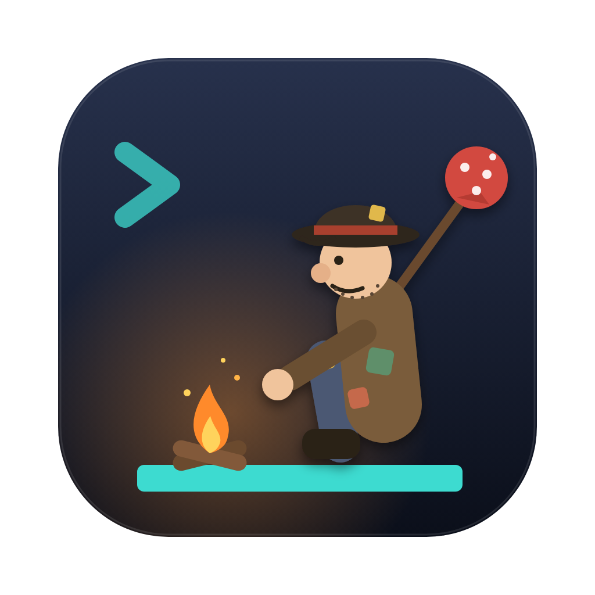

<p align="center"></p>

# SquatClient

A graphical **MUD / MUSH / MU\*** client for the desktop. It speaks the protocols real games use (telnet, TLS,
MCCP2, GMCP, MSDP and more), draws full UTF-8 text in 16, 256 and 24-bit colour, can be themed and rearranged
with layouts, is scriptable in a TinyFugue-compatible language and in Lua, and can keep your connections alive
while the window is closed by handing them to a small relay called a **squatter**.

It is free software, GPL-3.0-or-later.

- [Download](#download)
- [What it does](#what-it-does) · [Protocols](#protocols-and-terminal-support) · [Themes](#themes) · [Layouts](#layouts)
- [Build from source](#build-from-source)
- [Squatters: keeping connections alive](#squatters-keeping-connections-alive) · [squatterd](#squatterd) · [TinyFugue](#tinyfugue-and-the-tf-bridge)
- [Files and settings](#files-and-settings) · [Development](#development) · [Documentation](#documentation)
- [Code signing policy](#code-signing-policy) · [Privacy](#privacy) · [License](#license)

## Download

Releases are published on the **[Releases page](https://github.com/itsnotyoutoday/squatclient/releases)**:

| Platform | File |
|---|---|
| Windows (x64) | installer or portable `.exe` |
| macOS (Apple silicon / Intel) | `.app` bundle in a `.zip` |
| Linux (x64) | `squatclient` binary (needs GTK 3 and WebKitGTK) |

The client is one self-contained program. The optional relays (`squatterd` and `tf-squatterd`) come from the
[squatClientDaemon](https://github.com/itsnotyoutoday/squatClientDaemon) repository, as static binaries for
Linux, macOS and Windows. If there is no release for your platform yet, [build it from source](#build-from-source).

**Code signing:** free code signing provided by [SignPath.io](https://about.signpath.io), certificate by
[SignPath Foundation](https://signpath.org). See the [code signing policy](#code-signing-policy).

## What it does

- **Connects to anything that speaks telnet**, with or without TLS (certificate checking on by default, an
  explicit per-world switch to turn it off), UTF-8 or Latin-1.
- **Many connections in tabs**, with unread badges, an "ended" state that keeps the scrollback and says why the
  connection ended (it never reconnects behind your back), and a "While you were away" summary.
- **Fast output**: a virtualised scrollback with search, clickable links (OSC 8 and plain URLs), a command
  history per world that never stores passwords, and logging.
- **Worlds**: saved connections with keychain-stored passwords (never written to a file), auto-login,
  per-world layout, and **game-type detection** (PennMUSH, CobraMUSH, TinyMUX, TinyMUSH, RhostMUSH, TinyMUSE,
  CircleMUD/tbaMUD, ROM/Merc, SMAUG, LPmud, MOO, Evennia, MUCK, ColdMUD, CoffeeMUD, Iron Realms and others)
  that decides which tools apply.
- **An in-game object and attribute editor** for MU\* games: browse and edit objects, attributes, flags and
  locks in a workspace instead of typing `@set` lines.
- **Scripting in two languages**: a [TinyFugue-compatible language](docs/) (triggers, macros, hooks, timers,
  `/def`, `/load` of existing `.tf` files) and **Lua** plugins with an `squat.*` API. Scripts can open their own
  windows and panels.
- **Themes and layouts** (below), the keyboard-first input line, a file-upload dialog for sending long text,
  and a built-in searchable help browser.
- **Native feel**: native menus on macOS; an in-window menu bar on Windows and Linux. macOS is the primary
  development platform.
- **Squatters** that hold your connections while the app is closed (below).

## Protocols and terminal support

| Area | Supported |
|---|---|
| Transport | TCP, TLS (strict or, per world, unverified), UTF-8 and Latin-1 |
| Telnet options | ECHO (password prompts are masked in history and echo), SGA, EOR / GA prompt detection, NAWS (window size), TTYPE with **MTTS** capability reporting, CHARSET (UTF-8), **MCCP2** (zlib compression) |
| Out-of-band data | **GMCP** (JSON packages: `Char.Vitals`, `Room.Info`, `Comm.Channel.*`, `Char.Items.*`, ...). **MSDP** is decoded and delivered to scripts and layouts for games reached through the [TinyFugue bridge](#tinyfugue-and-the-tf-bridge) (TinyFugue built with `--enable-msdp`) |
| Text | ANSI SGR: 16, **xterm-256** and **24-bit truecolor**; bold, dim, italic, underline, strike, blink and reverse; OSC 8 hyperlinks; full UTF-8 |
| Relay protocols | **SWP** (SquatClient Wire Protocol) to `squatterd`, **TFSP** to TinyFugue's bridge; both run over WebSocket on TLS with pinned certificates and ed25519 device keys |

Protocol details and the choices made where specifications are silent are in
[`squatClientDaemon/docs/PROTOCOL.md`](https://github.com/itsnotyoutoday/squatClientDaemon/blob/main/docs/PROTOCOL.md)
and `PROTOCOL-NOTES.md`.

## Themes

The look of the whole window and of the game text is a **theme**: the 16 ANSI colours, default foreground and
background, cursor, selection, links, and the colours of the app's own panels. Three themes are built in
(**Dark**, **Light** and **High contrast**, which meets WCAG AAA for default text). Pick one in
**Settings → Theme**; it changes instantly, no restart.

Your own themes are files in the **themes folder** (shown in Settings): `<config dir>/themes/name.json`, or
`<config dir>/themes/name/theme.json`. The list updates within a second of saving a file, and a theme that is
not valid is skipped with a message naming the file.

```json
{
  "id": "night-owl", "name": "Night Owl", "kind": "dark",
  "fg": "#d6deeb", "bg": "#011627", "cursor": "#80a4c2", "selection": "#1d3b53", "link": "#82aaff",
  "ansi": ["#011627", "#ef5350", "#22da6e", "#addb67", "#82aaff", "#c792ea", "#21c7a8", "#d6deeb",
           "#575656", "#ef5350", "#22da6e", "#ffeb95", "#82aaff", "#c792ea", "#7fdbca", "#ffffff"],
  "chrome": { "panel": "#0b2942", "panelAlt": "#010e1a", "border": "#1d3b53", "text": "#d6deeb",
              "textDim": "#7e97ac", "accent": "#7e57c2", "accentText": "#ffffff",
              "danger": "#ef5350", "warn": "#ffcb8b", "ok": "#22da6e" }
}
```

A "minimum contrast" setting keeps text readable against any background a game chooses.

## Layouts

A **layout** arranges the window: where the game output, input line, docks and panels go, and which live game
data (GMCP / MSDP) they show. Layouts are chosen per world, per connection (Session → Connection settings), or as
the default (**View → Layouts…**). A game that sends vitals, a room and an inventory can get bars, a compass built
from the room's exits, a chat window and buttons, appearing only when the game has sent the data.

A layout is one file in the layouts folder, in the style of a single-file component:

```
<App>
  <Row>
    <Mush />
    <Dock side="right" width={240} resizable>
      <Vitals />
      <RoomInfo />
      <Chat height={150} />
    </Dock>
  </Row>
  <InputBar />
</App>

<script>
  // JavaScript / TypeScript, runs in the window
  const hp = useGmcp('Char.Vitals.hp');
</script>

<lua>
-- Lua, runs in the engine
squat.on("gmcp", function(e) --[[ ... ]] end)
</lua>

<style>
  /* CSS */
  .lay-gauge { height: 18px; }
</style>                          <!-- CSS -->
```

- Built-in layouts: Classic (the default), Sidebar, Vitals bar and an Evennia demo. The **Evennia cockpit**
  starter shows what is possible: resizable docks, a compass from the exit list, an HP chart, auto-heal, and
  Lua-built **Who** and **Help browser** windows made from the game's own output.
- Layouts are compiled in the app (esbuild), never loaded from the network, and one you did not write asks for
  your consent before it runs. If a layout fails, the classic layout is shown with a message saying why.
- JavaScript and Lua share variables both ways. Lua can open floating windows and docked panels with
  `squat.ui.window{...}` / `squat.ui.panel{...}` ([Lua API](https://github.com/itsnotyoutoday/squatClientDaemon/blob/main/docs/LUA-API.md)).

See [`docs/LAYOUTS.md`](docs/LAYOUTS.md).

## Build from source

You need **Go 1.24+**, **Node 20+** and the **Wails CLI**. On Linux also GTK 3 and WebKitGTK (`libgtk-3-dev`
and `libwebkit2gtk-4.0-dev`, or the `4.1` package with `-tags webkit2_41`); `wails doctor` tells you what is
missing. Windows needs the WebView2 runtime (already present on current Windows).

The client uses the engine from the daemon repository, so clone **both repositories side by side**:

```sh
mkdir squat && cd squat
git clone https://github.com/itsnotyoutoday/squatclient.git
git clone https://github.com/itsnotyoutoday/squatClientDaemon.git

go install github.com/wailsapp/wails/v2/cmd/wails@v2.10.2
cd squatclient
make build            # frontend, then the app
```

The result is `build/bin/squatclient.app` (macOS) or `build/bin/squatclient[.exe]`. `make run` builds and opens it
on macOS; `make dev` runs it with live reload. `make test` runs the Go and frontend tests, `make lint` the linters.

## Squatters: keeping connections alive

The app works fully on its own. A **squatter** is a relay that runs on a machine that stays on (a server, a Pi, a
VPS). It holds your game connections; you attach with the app, it replays what you missed, and you carry on. When you
close the app the connections stay up. SquatClient supports two kinds:

| | `squatterd` | TinyFugue bridge (`tf-squatterd`) |
|---|---|---|
| What holds the game connections | the relay itself | **your running TinyFugue** |
| Default port / path | 10327, `/swp` | 10328, `/tfsp` |
| Triggers and macros | run in SquatClient | run in TinyFugue (or SquatClient, by your choice) |
| Best for | a client-independent "screen for MUDs" | adding a GUI to the TinyFugue you already use |

Both use TLS with a self-signed certificate whose fingerprint **you confirm once and the app pins**, and
ed25519 device keys, so a pairing code is needed only the first time. Neither ever logs in for you or stores a game
password; the app sends your login.

### squatterd

On the machine that will hold the connections:

```sh
git clone https://github.com/itsnotyoutoday/squatClientDaemon.git
cd squatClientDaemon
make build                      # static binaries: ./squatterd and ./tf-squatterd (Go 1.24+)
./squatterd serve               # port 10327, TLS, data in ~/.squatterd
```

In another shell on the same machine:

```sh
./squatterd pair                # a one-time code (10 minutes), the TLS fingerprint and a host:port hint
```

In SquatClient: **cloud button → Squatters → Add a squatter**, Type **squatterd**, enter host, port and the code
and press **Pair**. The app shows the fingerprint *before* sending the code: compare it with what `squatterd
pair` printed, then **Trust and pair**. Then, in a world's settings, choose **Connect via** that squatter.

Useful commands: `squatterd devices` · `squatterd revoke <id>` · `squatterd status` ·
`squatterd reload` (restart onto a new binary **without losing game connections**) ·
`squatterd user ...` (named users, with ssh-key logins, on the server side).

Reaching it from outside your network: open port 10327, or keep it private and tunnel:

```sh
squatterd serve --bind 127.0.0.1 --insecure-loopback        # on the server
ssh -N -L 10327:127.0.0.1:10327 you@server                  # on your desktop; then use ws://127.0.0.1:10327/swp
```

Run it under systemd (`systemctl --user enable --now squatterd`, plus `loginctl enable-linger $USER`) or Docker;
the unit file, Docker commands and the security model are in the daemon's
[README](https://github.com/itsnotyoutoday/squatClientDaemon#readme).

### TinyFugue and the tf-bridge

If you already run [TinyFugue](https://github.com/ingwarsw/tinyfugue) in `screen` or `tmux`, it can be paired with
SquatClient the same way: you see all of TinyFugue's connections (history, then live), type into them, edit its world
list, and take the keyboard from, share it with, or hand it back to the TinyFugue terminal. TinyFugue keeps
running its own triggers.

The pieces: a TinyFugue build with the squat support (branch `squatterbridge` of the fork below) and the helper
`tf-squatterd`, which TinyFugue starts as its own child process. Nothing in TinyFugue listens on the network.

**1. Get and build TinyFugue (the fork with squat support)**

```sh
git clone -b squatterbridge https://github.com/itsnotyoutoday/tinyfugue.git
cd tinyfugue
./configure --prefix="$HOME/.local" --enable-gmcp --enable-msdp
make && make install
```

`--enable-gmcp` and `--enable-msdp` let the client see GMCP and MSDP data from games (MSDP needs `flex`).
TinyFugue also needs a C toolchain, OpenSSL and the ICU libraries (`libicu-dev`) as usual. On macOS, if linking
fails with missing `utext_*` / `ucnv_*` symbols, add `-licuuc` to `LIBS` in `src/Makefile` and run `make` again.
Make sure `~/.local/bin` is on your `PATH`.

**2. Build the bridge helper**

```sh
git clone https://github.com/itsnotyoutoday/squatClientDaemon.git     # skip if you already have it
cd squatClientDaemon && make build                                    # produces ./tf-squatterd
install -m 755 tf-squatterd ~/.local/bin/                             # anywhere on PATH
```

(or leave it where it is and tell TinyFugue: `/set squat_bin=/full/path/to/tf-squatterd`)

**3. Start it from TinyFugue**

Run TinyFugue, preferably inside `tmux new -s tf`, so it keeps running when you log out:

```
/squat on                    start the bridge (127.0.0.1:10328, TLS)
/squat pair                  print a one-time pairing code and the TLS fingerprint
```

`/squat pair operator` or `admin` pairs with a higher role (default: `operator`, which can type and open
connections; `admin` can also edit worlds' macro files, run allowed commands and upload scripts).

**4. Pair SquatClient**

**Cloud button → Squatters → Add a squatter**, Type **TinyFugue**, the host, port **10328** and the code. Compare the
fingerprint with the one TinyFugue printed, then **Trust and pair**. Your TinyFugue connections appear as tabs
marked **(tf)**. If TinyFugue runs on another machine, either set `/set squat_bind=0.0.0.0` before `/squat on` (and
open the port), or leave it on loopback and tunnel it: `ssh -N -L 10328:127.0.0.1:10328 you@server`, then add the
squatter as host `127.0.0.1`.

**Who has the keyboard.** Each TinyFugue connection has two switches, shown on its tab and in the status bar:
*input* (TinyFugue only / both / SquatClient only) and *automation* (whose triggers run). Set them from the app,
or in TinyFugue with `/control`. By default a paired operator can take over; `/set squat_takeover=ask` makes
TinyFugue ask you first (`/control allow`, `/control deny`). `/control <world> tf` always takes a world back, and
everything reverts to TinyFugue when the app disconnects.

**Settings** are ordinary TinyFugue variables, set before `/squat on`: `squat_port` (10328), `squat_bind`
(127.0.0.1), `squat_dir` (`~/.tf-squatter`), `squat_takeover` (`auto`, `ask`, `off`), `squat_exec` and
`squat_scripts` (both **off** by default; remote commands and uploaded scripts for admin devices; leave them off
unless you need them: `squat_exec=on` is the same as a shell on that account) and `squat_mtts`. The full list, the
control model and the security notes are in TinyFugue's `README.squat.md`.

Games must be read while in the background: keep TinyFugue's `/set background=on` (the default).

## Files and settings

| What | Where |
|---|---|
| Config directory | macOS `~/Library/Application Support/SquatClient` · Linux `~/.config/SquatClient` · Windows `%AppData%\SquatClient` (override: `SQUATCLIENT_CONFIG_DIR`) |
| Worlds, settings, squatters, window | `worlds.json`, `settings.json`, `squatters.json`, `window.json` in the config directory |
| Themes, layouts | `themes/` and `layouts/` in the config directory |
| Scripts | `startup.tf`, `plugins/*.lua`, `logs/` in the config directory (override: `SQUATCLIENT_SCRIPTS_DIR`) |
| Command history | `history/` in the config directory, one file per world |
| Game passwords, the device key | the operating system's keychain; never in a file |

## Development

```sh
make test          # go test -race ./... and the frontend tests (vitest)
make lint          # gofmt, go vet, staticcheck, tsc, eslint
make dev           # live reload
```

The app is Go (Wails v2) with a React + TypeScript front end. Game connections, the telnet engine, scripting and
the squatter client live in the [squatClientDaemon](https://github.com/itsnotyoutoday/squatClientDaemon)
repository as reusable packages (`pkg/...`). The app icon is drawn in `build/icon-source/squatter.svg`; render it
to `build/appicon.png` (1024×1024) and Wails builds the platform icons from that.

## Documentation

The app has a searchable **Help** browser (the `?` button or the Help menu) covering getting started, connecting,
settings, scripting, the Lua API, layouts and squatters. Design notes are in [`docs/`](docs/):
[`DESIGN.md`](docs/DESIGN.md), [`LAYOUTS.md`](docs/LAYOUTS.md), [`APP.md`](docs/APP.md),
[`EDIT.md`](docs/EDIT.md), [`SQUATTER-HUB.md`](docs/SQUATTER-HUB.md), [`ROADMAP.md`](docs/ROADMAP.md).

## Code signing policy

Free code signing provided by [SignPath.io](https://about.signpath.io), certificate by
[SignPath Foundation](https://signpath.org).

Windows release binaries are signed with a certificate provided by the SignPath Foundation. Only binaries built by
this project's own release workflow from the source in this repository are submitted for signing, and nothing is
signed that was not built from a tagged commit.

- **Committers and reviewers:** the [project maintainers](https://github.com/itsnotyoutoday)
- **Approvers:** the [project owner](https://github.com/itsnotyoutoday)

Every team member uses multi-factor authentication for the source repository and for SignPath. Changes from people
who are not maintainers are reviewed before they are merged. Each signing request is approved by an approver before
a release is signed.

## Privacy

This program will not transfer any information to other networked systems unless specifically requested by the user
or the person installing or operating it. It connects only to the game servers and squatters you configure.
Game passwords are kept in the operating system's keychain.

## License

GPL-3.0-or-later. See [`LICENSE`](LICENSE). SquatClient contains no TinyFugue code; its scripting language is an
independent implementation modelled on TinyFugue's documented behaviour.
